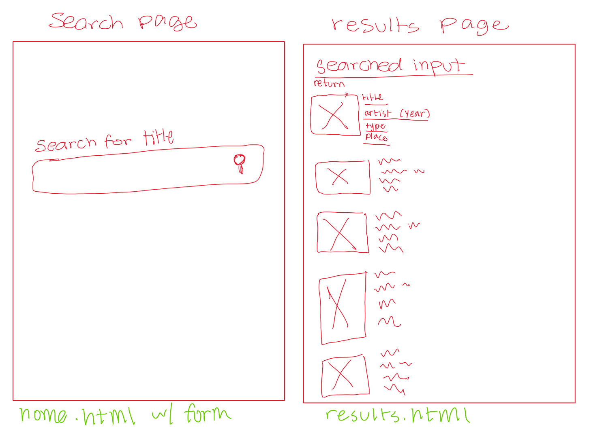

DATA NEEDED:
Fields: title, artist_title

SPEC PIECES: 

Route for "/"
    input: user enters flask app url
    output: Home Screen (home.html)
        checks: 
        1. (normal state) "cat" -> goes to results page
        2. empty input -> "enter input" message appears on home page 

Route for "/arts"
    input: user inputs title, and clicks search (app.py in use)
    output: results page (results.html); a list of artworks with their corresponding details is shown (happy path)
    output 2: results page with "no works found" message (no results)
    output 3: results page with "broken request: status code + reason" message (API error)
    output 4: missing fields are subbed with "Unknown"
        checks:
        1. "cat" input (normal state) -> results that have "cat" in title
        2. random string input (no results) -> results with "no results found" message

Function find_art(title) 
    A function that takes data from AIC API based off of user-entered title, and makes it callable from app.py 
    Should return the first 10 results from the data. (When in normal state)
        checks:
        1. When API is None, searching on webpage should show error message
        2. When API works, a search in home page for "water" should at most 10 artworks with "water" in their title. 
