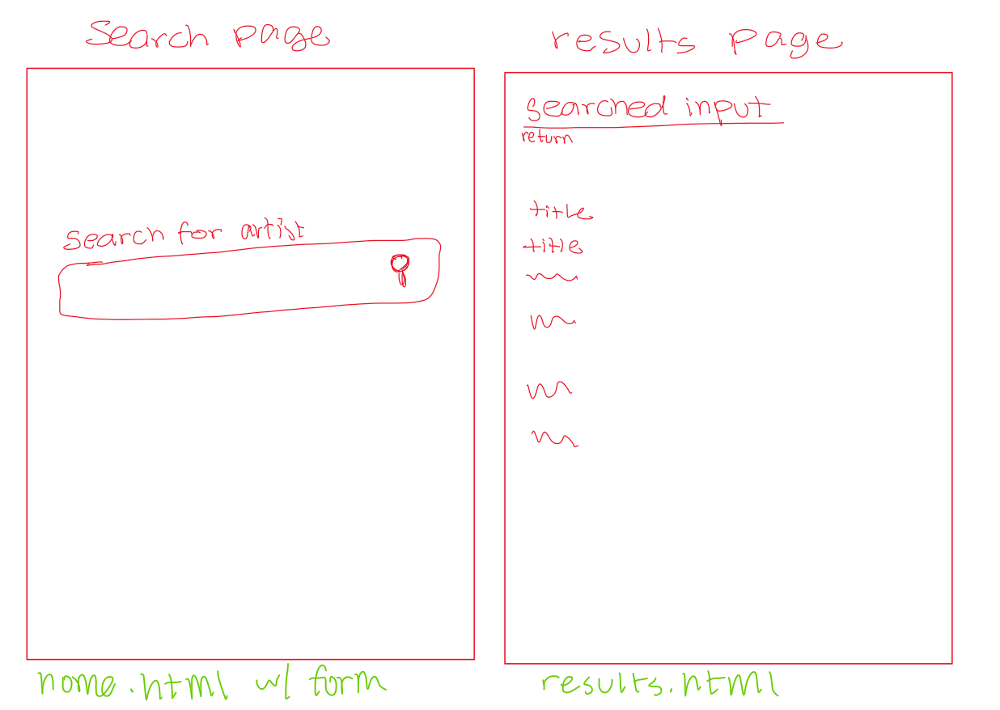

DATA NEEDED:
Fields: title, artist_title, q #we only need these two fields; artist_title and title, for matching input searches and getting responses. q is a field that helps search the AIC's API to get wanted results back

SPEC PIECES: 

Route for "/"
    input: user enters flask app url
    output: Home Screen (home.html)
        checks: 
        1. (normal state) "monet" -> goes to results page and shows monet works pass
        2. empty input -> "enter input" message appears on home page pass

Route for "/results"
    input: user inputs artist, and clicks search (app.py in use)
    output: results page (results.html); a list of artworks with their corresponding details is shown (happy path)
    output 2: results page with "no works found" message (no results)
    output 3: results page with "broken request: status code + reason" message (API error)
    output 4: missing fields are subbed with "Unknown"
        checks:
        1. "monet" input (normal state) -> results of art titles by monet pass
        2. random string input (no results) -> results with "no results found" message pass

Function find_art(title) 
    A function that takes data from AIC API based off of user-entered title, and makes it callable from app.py 
    Should return the first 10 results from the data. (When in normal state)
        checks:
        1. When API is None, searching on webpage should show error message pass
        2. When API works, a search in home page for "monet" should at most 10 artworks with "" titles of art by monet. pass

Function clean_arts(arts)- Used in api.py
    An AI Written function that deals with arts' empty field states. 
    As put by Claude, "Takes a list of artwork dictionaries and returns a new list with artist-less items dropped and missing titles set to "Unknown" "

Function keep_relevant(arts, term)- Used in api.py
    An AI Written function that helps determine when there are no relevent results.  
    As put by Claude, "Takes a list of artwork dictionaries and a search word, returns only those whose title or artist contains the word."