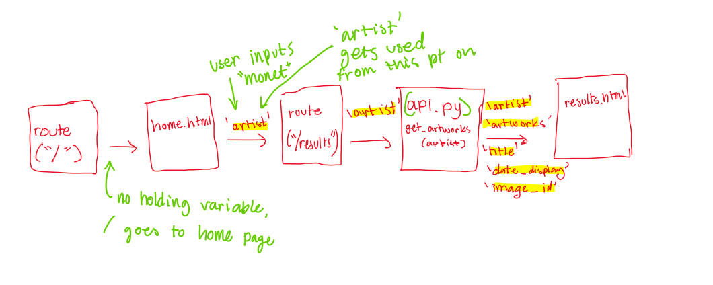

# HW5 findings

## 1. Drawing: one search for "Monet"
(photo here)

## 2. Two questions about the code
1. In the "/results" route, how does try: and except: work? 
2. How is try and except different from if and else, and how do you differenciate when's the best case to use each one?

## 3. Checks (4 or more, at least 2 as pytest tests)
| # | Check | Pass or fail |
|---|---|---|
| 1 | Checks that valid searches shows a page with results | PASS |
| 2 | Checks that empty searches should stay on home page, and include correct error message | PASS |
| 3 | Checks that random string search inputs should have no results on result page, and include correct error | FAIL (Originally) |
| 4 | Checks that only 10 results max are shown per search on results page | PASS |

## 4. AI review
What it found that I missed: 
    For security, the biggest problems pointed out were that the current debugger can allow remote code from outside the current machine, and should be debugged locally. The current exception message still gives a raw exception text to the user, and should instead change the {e} to a more generic message. It also reccommended putting a limit on the API upsteam calls, and using only Get insead of Post to avoid CSRF questions like "resubmit form" for every refresh. 
    
    For bugs and missing errors, the biggest problem brought up by ai was that "q=artist" is not limited to an artist only sketch- meaning that as long as an artist is mentioned in a description, that artwork will show up as a result, regardless if it was actually created by the searched artist. There's also some redundant code, and a lack of code handling timeout issues. It also pointed out the failed pytest check, where an empty result does not lead to a "No artworks found" message.

    For accessibility, claude reccomended to check the template pages for accessibility problems. It said to make sure that images have alt-text, make sure messages have an "alert" role for screen readers to announce it, label "artist", page titles assigned for each html template, html language set to "en", use headings, and make sure link's are descriptive. 

What it got wrong: 
    There was nothing AI got super wrong when pointing out errors/corrections, but also some of it's suggestions seemed not nesseccary. For example, in the bugs and missing errors section, one of their suggestions was to return specific http status' instead of just providing a "Human" error message. However, I don't think that's an error. The messages given to the user is enough info for them to see their mistakes, try again, or understand the issue. I don't think implementing the specific https error status code will help any user trying to use this app or troubleshoot their mistakes- A human readable message would be more helpful for most instead of recieving a status code (like Claude suggested).

Answers to my two questions, in my own words:
    1. How Try and Except work: if 'Try' works, it executes the code inside of it. 'Try' attempts to run the code inside of it. However, if 'Try' does not work, it will skip to the the 'except' and run the code inside if that block instead. Try and except pair together. 
    2. How Try/Except differs from If/Else: If/Else doesn't run the code inside of them if their attached conditional does pass. As claude put is, "checks a condition BEFORE acting". With Try/Except, there does not need to be a conditional attached to it. 'Try' will run the code associated with it, and if it doesn't work, it will go to the 'Except" actions. As Claude writes, "handles failures you can't predict by looking ahead". Try/Except requires one to try the code out to find an answer, while If/Else has a conditional to try before executing the code. (Side note: 'except' only runs if there was an error with 'try')

## 5. My fix
What was wrong: The test for inputting a random string into the search was failing. This was because any time a random string was inputted and searched, results with no association would still come up. While the api was using the artist keyword as a search term, when it couldn't find a matched artist, it would provide its "next best" results, which wouldn't be useful to the inputted search at all. The test itself was checking for the words "No results found." which was nowhere to be found because results were still on the page. 

What I changed: Using AI, I changed the params a bit in api.py. 
    Instead of:
    params = {"q": artist, "fields": FIELDS, "limit": 10}

    params = {
        "query[match][artist_title][query]": artist,
        "query[match][artist_title][operator]": "and",
        "fields": FIELDS,   # back to the comma-separated string
        "limit": 10,
    }

    This is makes the search query more specific, finding the exact match of inputted artist name while getting it's data. It only pulls works that match the search, and if it can't find any it will return an empty data list, which will trigger the "No results found" message. 

How I checked it works: I ran the pytest check that tested for the "No results found." message and this time it passed. I also tried it out for myself on the local server, inputting a random string for search, and saw a "No results found." message as well. 

Commit before: (69e6a5814fb70d5945be7cce57e143cddca1e959)  Commit after: (e0b7cbf19432bafcfb2b64525d1cffe3181cb114)

## 6. Can we ship it? (100–150 words)
Yes or no, and why: 
No, while we can ship this app tomorrow, I don't think we should. Even though this app is usable and someone could find art by an artist with this search, it is pretty bare bones and basic. Why would people want to use this app when Google exists. Also, at this current moment, Google would probably have a better looking/formatted results page than our app. Our's looks like a literal list, Google's results have the artworks in a table format, but highlighting the images over the titles, and other details. If we were to try and ship this with a goal of people actually wanting to use this app over other search engines (like Google) we'd need to better our app's design, and find a way to implement features that would make our art searching app stand out. 

One thing my HW4 does better: HW4 is better at making sure more checks are taken care of, and also did a better job at helping me understand all the different components and files that go into making an app/website. Since a lot of app, api, and templates were made by me last time, I really had to understand what each file did, and how the code worked. Also, in HW 4, I really made it a point to test different checks, even though it was without pytest telling me how many passed/failed, it did feel like more of an effort was put in HW4 to make sure common errors were properly taken care of.HW 4 also checked for missing fields, and either changed it to "Unknown" or dropped the artwork completely from the returned artworks data. I'm not sure if AI's app does the same, since I didn't focus any of my tests this tine on checking missing fields.  

One thing the AI's app does better: AI's app did a better job a being more efficient overall. The app itself was made in minutes, maybe even seconds. I got to spend less time making the actual product and more time working on refining/debugging it. Also with the pytests, I got to check if things were functioning properly faster. I didn't have to manually look for messages/outputs, running pytest would allow me to see passes/fails easier. After pointing out the error for random input search, it had a more accurate fix compared to HW4. While HW4 still get's the "No results" message, it still kept in results with similar titles to the artists name, not just work by the artist name. AI's app, only keeps artworks if it's artist title matches the user input. 

AI use goes in `ai_use.md` (the five points on the AI Use Card).
